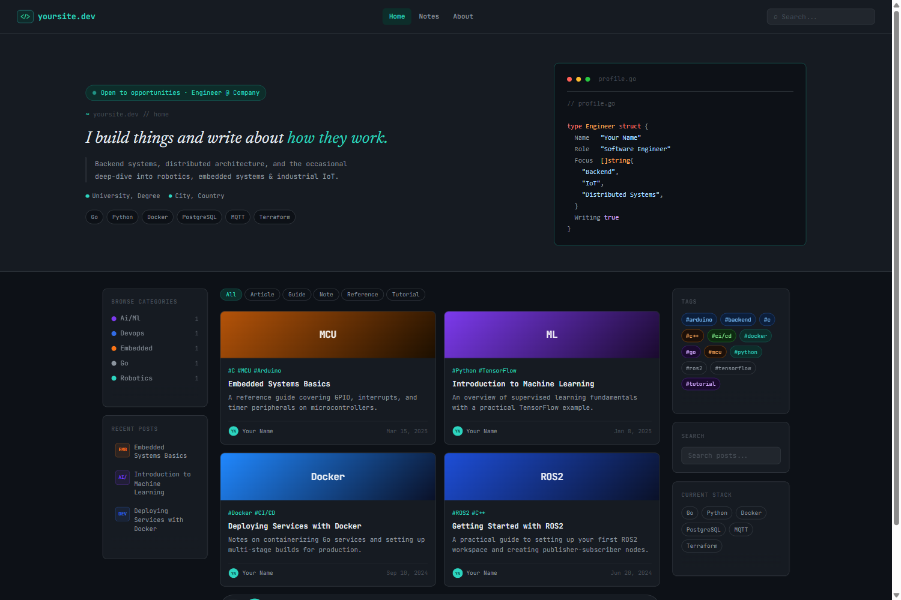

# NotesEdge

A dark, GitHub-inspired Hugo theme for technical writers and engineers. Built with a monospace-first design, 2-column layout, and client-side search — no build tools required.


---

## Preview



---

## Features

- **Dark theme** — GitHub-inspired palette with teal accents
- **2-column layout** — Left sidebar (categories, tags), center content area with card carousel
- **Client-side search** — Fuse.js fuzzy search with `Cmd/Ctrl + K` shortcut and a mobile icon-button trigger
- **Content filtering** — Filter posts by `content_types` taxonomy
- **Post carousel** — Paginated card view with previous/next navigation, page size configurable via `carousel_page_size`
- **Optional post series** — Add ordered multi-part series with dedicated previous/next-in-series navigation
- **Code highlighting** — Hugo's `github-dark` syntax theme with copy buttons
- **Multiple taxonomies** — `tags`, `categories`, `content_types`
- **Responsive** — Mobile-first, adapts at 900px and 600px breakpoints
- **No framework dependencies** — Vanilla CSS with custom properties, vanilla JS
- **Configurable hero** — Toggle, parameterize, and choose the code-block language via presets
- **Language-flexible hero code** — Switch between Go, Rust, C++, C, JS/TS, Python syntax via `language` preset
- **Default favicon bundled** — Override with `params.favicon` if you want a custom one
- **Google Fonts toggle** — Disable web fonts for privacy or performance
- **i18n ready** — All UI strings translatable via `i18n/` files
- **SEO optimized** — Open Graph, Twitter Cards, canonical URLs
- **Extensibility hooks** — Override `head.html` and `comments.html` partials
- **Unified category config** — One `[params.categories]` table for sidebar dot color, card thumbnail gradient, and label

---

## Requirements

- Hugo `0.110.0` or later (extended version recommended)

---

## Quick start

```bash
hugo new site mysite
cd mysite
git init
git submodule add https://github.com/ali-aiar/notesedge themes/notesedge
cp -r themes/notesedge/exampleSite/. .
hugo server
```

---

## Installation

### As a Git submodule

```bash
git submodule add https://github.com/ali-aiar/notesedge themes/notesedge
```

### Manual

Download the theme and place it in your site's `themes/notesedge/` directory.

Then set the theme in your `config.toml`:

```toml
theme = "notesedge"
```

---

## Configuration

Full `config.toml` example:

```toml
baseURL = "https://yoursite.dev"
title   = "yoursite.dev"
languageCode = "en-us"
theme   = "notesedge"
paginate = 10

[taxonomies]
  tag          = "tags"
  category     = "categories"
  content_type = "content_types"

[params]
  show_hero     = true      # Toggle hero section on homepage (default: true)
  google_fonts  = true      # Load IBM Plex Mono + IBM Plex Serif from Google Fonts (default: true)
  carousel_page_size = 4    # Posts per page in the homepage carousel (default: 4)
  author        = "Your Name"
  tagline       = "I build things and write about <strong>how they work.</strong>"
  description   = "Short bio shown in the hero section."
  role          = "Your Role @ Company"
  location      = "City, Country"
  education     = "University, Degree"

  hero_status   = "Open to opportunities"

  favicon       = "/favicon.svg"
  logo          = "/logo-brand.png"

  github        = "https://github.com/yourusername"
  linkedin      = "https://linkedin.com/in/yourusername"
  email         = "you@example.com"
  theme_repo    = "https://github.com/ali-aiar/notesedge"
  show_theme_credit = true  # Show the theme credit link in the footer (default: true)

  # Hero code block: data-driven, swap languages via `language` preset
  [params.hero_code]
    language  = "go"             # go | rust | cpp | c | javascript | js | typescript | ts | python
    type_name = "Engineer"       # only required field beyond language + fields

    [[params.hero_code.fields]]
    label = "Name"
    value = "Your Name"           # default kind: string

    [[params.hero_code.fields]]
    label = "Role"
    value = "Software Engineer"

    [[params.hero_code.fields]]
    label = "Focus"
    value = ["Backend", "IoT", "Distributed Systems"]
    kind  = "array"               # renders as the language's array type

    [[params.hero_code.fields]]
    label = "Writing"
    value = true
    kind  = "bool"                # renders as true / false

  # Optional: Open Graph fallback image
  # og_image    = "/images/og-default.png"

  [params.categories]
    robotics     = { color = "#2dd4bf", from = "#1d4ed8", to = "#0a1128", label = "ROS2"   }
    embedded     = { color = "#f97316", from = "#b45309", to = "#1c0f00", label = "ESP32"  }
    "go/backend" = { color = "#00ACD7", from = "#00ACD7", to = "#003B52", label = "Go"     }
    "ai/ml"      = { color = "#7c3aed", from = "#7c3aed", to = "#1a0a2e", label = "ML"     }
    "cloud/iot"  = { color = "#FF9900", from = "#0f766e", to = "#042f2e", label = "IoT"    }
    devops       = { color = "#326CE5", from = "#2088FF", to = "#0a1128", label = "DevOps" }

[markup.highlight]
  style     = "github-dark"
  noClasses = true

[outputs]
  home = ["HTML", "RSS", "JSON"]

[menu]
  [[menu.main]]
    name = "Home"
    url  = "/"
    weight = 1
  [[menu.main]]
    name = "Notes"
    url  = "/notes/"
    weight = 2
  [[menu.main]]
    name = "About"
    url  = "/about/"
    weight = 3
```

### Post Front Matter

In addition to the standard fields, posts can optionally join an ordered series:

```toml
title = "Building a Go API — Part 1"
date = 2025-04-01
categories = ["Go/Backend"]
tags = ["Go", "API", "Series"]
content_types = ["Tutorial"]
authors = ["Your Name"]
series = "Building a Go API"
series_order = 1
summary = "Start a four-part API series with project layout and bootstrapping."
```

When `series` and `series_order` are present, the single-post page prefers navigation within that ordered series. Posts without these fields keep the default section-based previous/next behavior.

---

## Hero Section

The hero section on the homepage is highly customizable. Toggle it with `params.show_hero` (default: `true`).

### Hero Parameters

| Parameter | Description | Default |
|-----------|-------------|---------|
| `show_hero` | Show/hide the entire hero section | `true` |
| `author` | Display name in hero bio | — |
| `tagline` | HTML-enabled tagline below name | — |
| `description` | Short bio paragraph | — |
| `role` | Role shown in status badge | i18n `hero_role_default` |
| `location` | City/country in bio | — |
| `education` | University/degree in bio | — |
| `hero_status` | Status badge text | i18n `hero_status_default` |
| `carousel_page_size` | Posts per page in the homepage carousel | `4` |
| `hero_code` | Language-flexible data-driven hero code block (see [Hero Code](#hero-code)) | `{}` |
| `github` | GitHub profile URL | — |
| `linkedin` | LinkedIn profile URL | — |
| `email` | Contact email | — |
| `theme_repo` | Footer link target for the theme credit | Default NotesEdge repo |
| `show_theme_credit` | Show/hide the site-title-based footer credit link | `true` |

### Hero Code

The hero code block is **language-flexible** and **data-driven**. Pick a `language` preset to get sensible defaults for the keyword, block style, array type, filename, and **field syntax** (separator, terminator, array brackets, bool literals) — then just list your fields. You can still override any preset value explicitly.

Supported `language` presets (defined in `data/hero_code_languages.toml`):

| `language`        | opener    | block     | array type       | `sep`   | `terminator` | bools        | brackets | default filename |
|---|---|---|---|---|---|---|---|---|
| `go`              | `type`    | `struct`  | `[]string`       | `   `   | _(none)_     | `true/false` | `{}`     | `profile.go`     |
| `rust`            | _(none)_  | `struct`  | `Vec<&str>`      | `: `    | `,`          | `true/false` | `{}`     | `profile.rs`     |
| `cpp`             | _(none)_  | `struct`  | `vector<string>` | ` = `   | `;`          | `true/false` | `{};`    | `profile.cpp`    |
| `c`               | `typedef` | _(none)_  | `char*[]`        | ` = `   | `;`          | `true/false` | `{};`    | `profile.h`      |
| `javascript`/`js` | `class`   | _(none)_  | `Array`          | ` = `   | `,`          | `true/false` | `[]`     | `profile.js`     |
| `typescript`/`ts` | `interface` | _(none)_ | `Array`        | `: `    | `;`          | `true/false` | `[]`     | `profile.ts`     |
| `python`          | `class`   | _(none)_  | `list`           | ` = `   | _(none)_     | `True/False` | `[]`     | `profile.py`     |

Field syntax per language:

- **`sep`** — characters between label and value (e.g. Go: `Name   "Your Name"`; Rust: `name: "Your Name",`)
- **`terminator`** — end-of-line (e.g. `;` for C/C++/TS, `,` for Rust/JS, empty for Go/Python)
- **`bools`** — literal text for boolean values (`True/False` for Python, `true/false` elsewhere)
- **`brackets`** — array syntax (Go/Rust/C/C++ use `{ }`, JS/TS/Python use `[ ]`)

```toml
[params.hero_code]
  language  = "rust"
  type_name = "Engineer"

  [[params.hero_code.fields]]
  label = "Name"
  value = "Your Name"

  [[params.hero_code.fields]]
  label = "Focus"
  value = ["Backend", "IoT"]
  kind  = "array"

  [[params.hero_code.fields]]
  label = "Writing"
  value = true
  kind  = "bool"
```

Renders as:

```
struct Engineer {
  Name: "Your Name",
  Focus: Vec<&str>{
    "Backend",
    "IoT",
  },
  Writing: true,
}
```

To add a new language, append an entry to `data/hero_code_languages.toml` — no template edit needed. To override a single preset value on a site, set the corresponding field explicitly in `[params.hero_code]` (`filename`, `type_keyword`, `block_keyword`).

### Category Settings

Map each category to a single config entry holding its sidebar-dot color, card-thumbnail gradient, and label — one row, four fields.

```toml
[params.categories]
  robotics     = { color = "#2dd4bf", from = "#1d4ed8", to = "#0a1128", label = "ROS2"  }
  embedded     = { color = "#f97316", from = "#b45309", to = "#1c0f00", label = "ESP32" }
  "go/backend" = { color = "#00ACD7", from = "#00ACD7", to = "#003B52", label = "Go"    }
```

Keys must match your category names (lowercase). Categories without a mapping use neutral fallbacks (`color = #8b949e`, gradient = surface colors, no label).

---

## Typography

The theme ships with **IBM Plex Mono** (chrome / UI / code) and **IBM Plex Serif** (prose — hero tagline, post titles, post body, card excerpts) loaded from Google Fonts. The split is set in the CSS via `--font-mono` and `--font-serif` custom properties; no fonts are hard-coded in component rules.

To use system fonts or self-host instead, set `params.google_fonts = false`.

---

## i18n / Translations

All UI strings are translatable. The theme ships with English defaults in `i18n/en.toml`.

| Key | Default | Used in |
|-----|---------|---------|
| `hero_status_default` | "Available" | Hero status badge |
| `hero_role_default` | "Software Engineer" | Hero status badge |
| `nav_search_placeholder` | "⌕ Search..." | Navigation bar input |
| `search_title` | "Search" | Nav search trigger button aria-label |
| `search_placeholder` | "Search posts, tags, topics..." | Search overlay |
| `search_empty_state` | "Start typing to search..." | Search overlay |
| `search_loading` | "Loading index..." | Search overlay |
| `search_no_results_prefix` | "No results for" | Search overlay |
| `search_load_error` | "Could not load search index." | Search overlay |
| `search_results_summary` | "Showing %END% of %TOTAL% posts" | Search overlay |
| `min_read` | "min read" | Single post page |
| `previous_post` | "← previous" | Post navigation |
| `next_post` | "next →" | Post navigation |
| `previous_in_series` | "← previous in series" | Series post navigation |
| `next_in_series` | "next in series →" | Series post navigation |
| `categories_title` | "Categories" | Left sidebar |
| `tags_title` | "Tags" | Left sidebar |
| `filter_all` | "All" | Content type filter |
| `post_count_suffix` | "posts" | List pages |
| `built_with` | "Built with" | Footer |
| `page_not_found` | "Page Not Found" | 404 page |
| `page_not_found_message` | "The page you're looking for doesn't exist or has been moved." | 404 page |
| `back_to_home` | "← Back to Home" | 404 page |
| `copy` | "copy" | Code block button |
| `copied` | "copied!" | Code block button |
| `carousel_prev` | "Previous" | Post carousel navigation |
| `carousel_next` | "Next" | Post carousel navigation |

### Adding a New Locale

1. Copy `i18n/en.toml` to `i18n/{lang}.toml` (e.g., `i18n/fr.toml`)
2. Translate each `other = "..."` value
3. Set `languageCode` in your site config to match (e.g., `languageCode = "fr"`)

Hugo automatically picks the correct file based on your site's language code.

---

## SEO Meta Tags

The theme automatically generates optimized meta tags for search engines and social sharing:
- Canonical URLs
- Open Graph tags (`og:title`, `og:description`, `og:image`, etc.)
- Article-specific tags for posts (published time, author, tags)
- Twitter Card support (`summary_large_image`)
- RSS autodiscovery

Front matter fields used for SEO:
- `summary` → Description
- `thumbnail` → Social sharing image
- `authors` → Article author
- `tags` → Article tags

Use `params.og_image` in your config as a site-wide fallback image.

---

## Extensibility Hooks

You can customize the theme without modifying its core files using these partial hooks:
1. `layouts/partials/head.html` — Injected into the `<head>` section. Use this for custom meta tags, analytics (e.g., Plausible, Umami), or additional CSS.
2. `layouts/partials/comments.html` — Injected after post content on single pages. Empty by default. Use this to integrate comment systems like Giscus or Disqus.

---

## Search

Search uses [Fuse.js](https://fusejs.io/) v7 loaded from CDN. The search index is generated from Hugo's JSON output at `/index.json`.

**Keyboard shortcut:** `Cmd+K` (macOS) / `Ctrl+K` (Windows/Linux)

Search weights:

| Field | Weight |
|---|---|
| Title | 0.5 |
| Tags | 0.3 |
| Summary | 0.15 |
| Categories | 0.05 |

---

## Layout Structure

```
archetypes/
└── default.md                # Post archetype
assets/
├── css/
│   └── main.css              # Theme stylesheet
└── js/
    ├── carousel.js           # Post carousel logic
    ├── code-block.js         # Code copy button
    └── search.js             # Fuse.js search overlay
i18n/
└── en.toml                   # English UI strings
static/
└── favicon.svg               # Default theme favicon (`</>` glyph)
data/
└── hero_code_languages.toml  # Language presets for the hero code block
layouts/
├── 404.html
├── index.html                # Homepage with hero + post carousel
├── index.json                # Search index template
├── _default/
│   ├── baseof.html           # Base HTML wrapper
│   ├── single.html           # Individual post page + optional series navigation
│   └── list.html             # Category / tag list pages
├── page/
│   └── about.html            # About page
└── partials/
    ├── card.html
    ├── comments.html         # Comment system hook (empty by default)
    ├── footer.html
    ├── head.html             # SEO meta tags + extensibility hook
    ├── hero.html
    ├── nav.html
    └── search.html
```

### Adding a New Hero Code Language

Append an entry to `data/hero_code_languages.toml`:

```toml
[zig]
type_keyword  = "const"
block_keyword = "struct"
array_type    = "[]const []const u8"
filename      = "profile.zig"
```

Then set `language = "zig"` in `[params.hero_code]`. No template or partial edits required.

---

## License

MIT — see [theme.toml](theme.toml) for details.

---

## Author

Built by [Ali Ilham](https://aliilham.dev)
