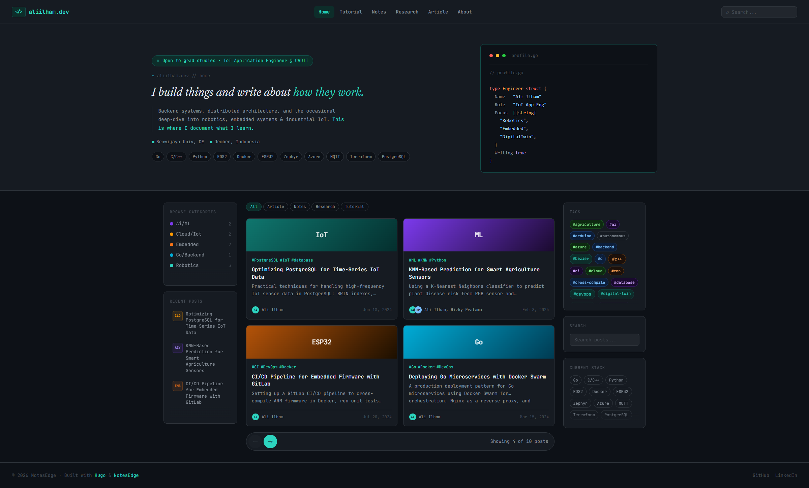
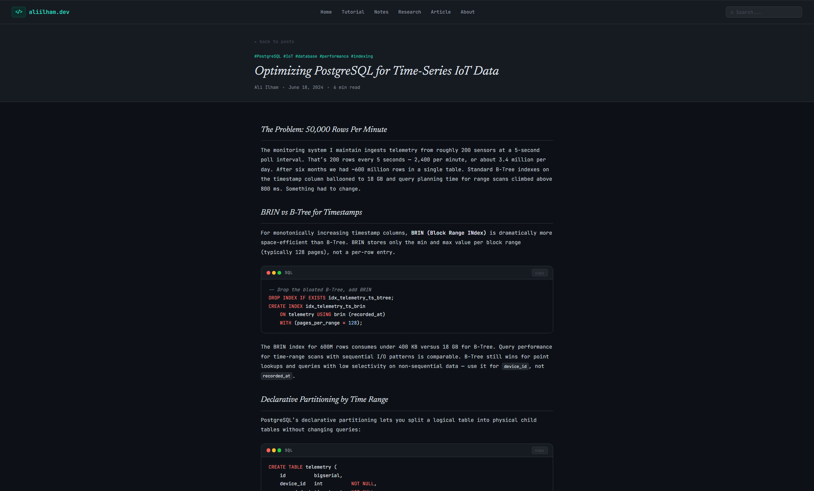
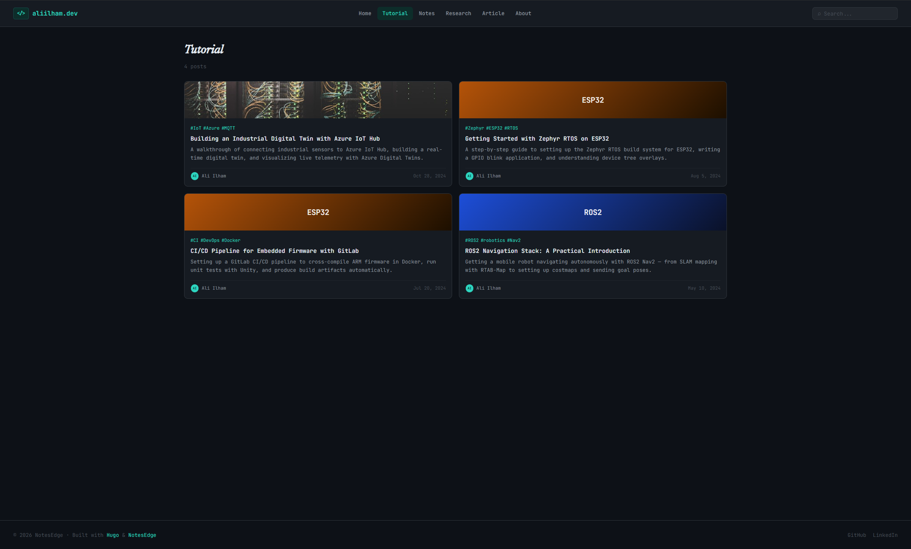

# NotesEdge

A dark, GitHub-inspired Hugo theme for technical writers and engineers. Built with a monospace-first design, multi-column layout, and client-side search — no build tools required.


---

## Preview







---

## Features

- **Dark theme** — GitHub-inspired palette with teal accents
- **3-column layout** — Left sidebar (categories, recent posts), center cards, right sidebar (tags, stack, search)
- **Client-side search** — Fuse.js fuzzy search with `Cmd/Ctrl + K` shortcut
- **Content filtering** — Filter posts by `content_types` taxonomy
- **Post carousel** — 4-post paginated view with previous/next navigation
- **Code highlighting** — Hugo's `github-dark` syntax theme with copy buttons
- **Multiple taxonomies** — `tags`, `categories`, `content_types`
- **Responsive** — Mobile-first, adapts at 900px and 600px breakpoints
- **No framework dependencies** — Vanilla CSS with custom properties, vanilla JS
- **Hero section** — Decorative Go code block, bio, stack pills, and tagline

---

## Requirements

- Hugo `0.110.0` or later (extended version recommended)

---

## Quick start

```bash
hugo new site mysite
cd mysite
git init
git submodule add https://github.com/ali-aiar/notesedge themes/notesedge
cp -r themes/notesedge/exampleSite/. .
hugo server
```

---

## Installation

### As a Git submodule

```bash
git submodule add https://github.com/ali-aiar/notesedge themes/notesedge
```

### Manual

Download the theme and place it in your site's `themes/notesedge/` directory.

Then set the theme in your `config.toml`:

```toml
theme = "notesedge"
```

---

## Configuration

Full `config.toml` example:

```toml
baseURL = "https://yoursite.dev"
title   = "yoursite.dev"
languageCode = "en-us"
theme   = "notesedge"
paginate = 10

[taxonomies]
  tag          = "tags"
  category     = "categories"
  content_type = "content_types"

[params]
  author      = "Your Name"
  tagline     = "I build things and write about <strong>how they work.</strong>"
  description = "Short bio shown in the hero section."
  role        = "Your Role @ Company"
  location    = "City, Country"
  education   = "University, Degree"

  # Hero status badge
  hero_status = "Open to grad studies"

  # Terminal prompt label in hero
  hero_prompt = "yoursite.dev // home"

  # Branding (files placed in your site's static/ folder)
  favicon  = "/favicon.svg"   # supports .svg, .png, .ico
  logo     = "/logo-brand.png"

  # Social links
  github   = "https://github.com/yourusername"
  linkedin = "https://linkedin.com/in/yourusername"
  email    = "you@example.com"

  # Stack pills shown in hero and right sidebar
  stack = ["Go", "Python", "Docker", "PostgreSQL"]

  # Hero decorative code block
  code_filename = "profile.go"
  code_name     = "Your Name"
  code_role     = "Your Role"
  code_focus    = ["Topic1", "Topic2", "Topic3"]
  code_writing  = true

[markup.highlight]
  style     = "github-dark"
  noClasses = true

[outputs]
  home = ["HTML", "RSS", "JSON"]
```

### Navigation menu

```toml
[menu]
  [[menu.main]]
    name = "Home"
    url  = "/"
    weight = 1
  [[menu.main]]
    name = "Notes"
    url  = "/notes/"
    weight = 2
  [[menu.main]]
    name = "About"
    url  = "/about/"
    weight = 3
```

---

## Content

### Post front matter

```yaml
---
title: "Your Post Title"
date: 2024-01-15
categories: ["Robotics"]
tags: ["ROS2", "C++"]
content_types: ["Tutorial"]
authors: ["Your Name"]
summary: "Short excerpt shown in cards and search results."

# Optional thumbnail
thumbnail: "/images/post-thumb.jpg"
thumb_label: "ROS2"   # Label shown on card thumbnail (defaults to category)
---
```

### Category thumbnail colors

The card thumbnail gradient is derived from the post's first category:

| Category keyword | Color |
|---|---|
| IoT, Cloud | Dark teal |
| Robotics, ROS | Dark blue |
| AI, ML | Purple |
| Embedded, MCU | Amber |
| Go, Backend | Cyan |
| DevOps | GitHub blue |

Posts with a `thumbnail` image override the gradient entirely.

### About page

Create `content/about.md` with `layout: about` to use the dedicated about template:

```yaml
---
title: "About"
layout: "about"
---
```

---

## Search

Search uses [Fuse.js](https://fusejs.io/) v7 loaded from CDN. The search index is generated from Hugo's JSON output at `/index.json`.

**Keyboard shortcut:** `Cmd+K` (macOS) / `Ctrl+K` (Windows/Linux)

Search weights:

| Field | Weight |
|---|---|
| Title | 0.5 |
| Tags | 0.3 |
| Summary | 0.15 |
| Categories | 0.05 |

---

## Layout Structure

```
layouts/
├── 404.html
├── index.html            # Homepage with hero + post carousel
├── index.json            # Search index template
├── _default/
│   ├── baseof.html       # Base HTML wrapper
│   ├── single.html       # Individual post page
│   └── list.html         # Category / tag list pages
├── page/
│   └── about.html        # About page
└── partials/
    ├── nav.html
    ├── hero.html
    ├── card.html
    ├── footer.html
    └── search.html
```

---

## License

MIT — see [theme.toml](theme.toml) for details.

---

## Author

Built by [Ali Ilham](https://aliilham.dev)
